<p align="center">
  
</p>

<h1 align="center">Caderna</h1>

<p align="center"><b>Built on the Know Giver white-label base</b></p>

<h3 align="center">Your exam. Your plan. A teacher who talks back.</h3>

<p align="center">
  <a href="README.md">English</a> · <a href="README.pt-BR.md">Português (Brasil)</a> · <a href="README.ja.md">日本語</a> · <a href="README.zh-Hans.md">简体中文</a> · <a href="README.zh-Hant.md">繁體中文</a>
</p>

<p align="center">
  <b>A desktop app that builds study plans for exams, built in pure Rust.</b><br>
  Drop in the exam notice or syllabus PDF, get a week-by-week plan, and study out loud with a tutor that listens, explains and quizzes you.
</p>

<p align="center">
  <a href="https://www.rust-lang.org"></a>
  <a href="https://github.com/emilk/egui"></a>
  <a href="https://www.sqlite.org"></a>
  <a href="https://typst.app"></a>
  
  <a href="https://github.com/rhasspy/piper"></a>
  
  
  <a href="https://github.com/ggml-org/llama.cpp"></a>
  <a href="https://www.vulkan.org/"></a>
  
  
  
  <a href="#license"></a>
  
  
</p>

<br>

<p align="center">
  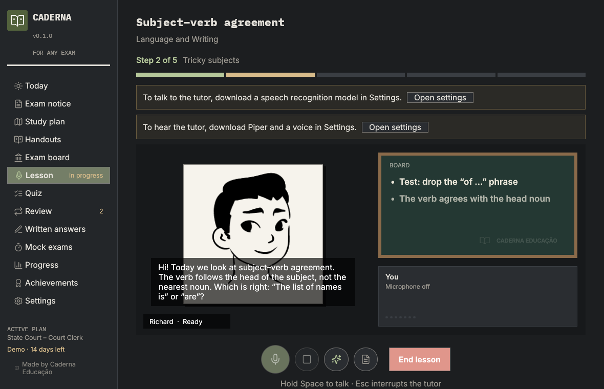
</p>

<p align="center">
  <a href="#from-syllabus-to-plan">Syllabus → plan</a> ·
  <a href="#voice-lessons">Voice lessons</a> ·
  <a href="#a-whiteboard-that-shows-not-just-tells">Whiteboard</a> ·
  <a href="#teachers--voices">Teachers</a> ·
  <a href="#read-and-highlight-your-handouts">Reader</a> ·
  <a href="#practice-review-handouts">Practice</a> ·
  <a href="#written-answers">Written answers</a> ·
  <a href="#first-run">First run</a> ·
  <a href="#private-by-default">Privacy</a> ·
  <a href="#quick-start">Quick start</a> ·
  <a href="#development">Development</a>
</p>

<br>

## From syllabus to plan

The exam notice is read on your machine; only its syllabus goes to the AI.

- **Pick your role.** Some exams cover several positions. Caderna finds them and
  asks which one you are applying for, so the plan has the shared subjects plus only
  *your* position's specific ones.
- **Your schedule.** Number of weeks and hours per week shape a plan by week, subject
  and topic. Keep several exams side by side.
- **Scanned PDFs.** Pages without text can be transcribed by a vision model you configure.

<p align="center">
  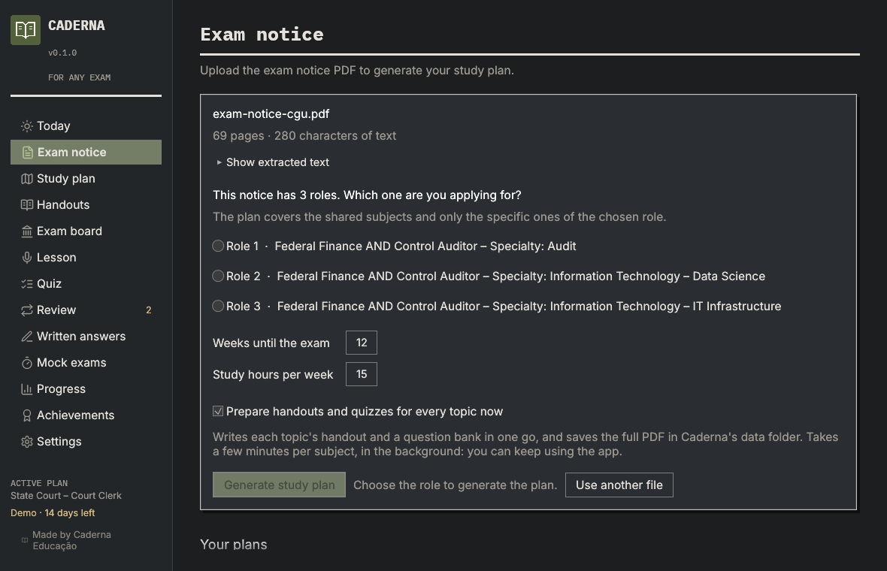
</p>

## Voice lessons

You speak, the tutor answers out loud, like a call with a patient teacher.

### 🎙️ Listening
Local speech recognition: **Parakeet** for live captions while you talk, **Whisper**
as a second opinion on short or doubtful answers. The microphone stays open for the
whole lesson, soft voices are brought up before recognition, and your turn ends after
a pause you choose in Settings, so you can stop to think of a word.

### 🗣️ Speaking
The tutor starts talking with the first sentence of its answer, says "Hum." while it
thinks, and stops when you interrupt. Captions follow its voice, sentence by sentence. Hands-free, push-to-talk (Space) or typing.

### 🧭 A lesson with a beginning and an end
Every lesson follows a plan built from the topic's handout (or written by the
teacher): each step brings the handout's key points, the teacher checks you got them
before moving on, and everything the quiz will ask is covered along the way. You
always see where you are ("Step 2 of 5"), and the lesson closes with a summary and an
offer to take the quiz. Pick **Quick**, **Normal** or **Full** lessons in Settings.
Taken lessons get a tick in your plan and keep their plan, board and closing words to
look back at. Leave a lesson halfway and **Continue lesson** picks it up later. English
words and sentences can be read in an English voice of their own.

### 🧠 Teaching
Any OpenAI-compatible model (Ollama, LiteLLM, GLM, …) behind tutor prompts written for
spoken conversation: short turns, one idea at a time, questions back to you. Prompts
follow the app's language: Portuguese by default, English when the app is in English.

## A whiteboard that shows, not just tells

Besides key points, the tutor writes **formulas**, **diagrams**, **comparison tables**,
**timelines**, **mind maps**, **"on the exam" tips**, **worked examples**, and puts up
**pictures** from Wikipedia (only the search term leaves your computer).

<p align="center">
  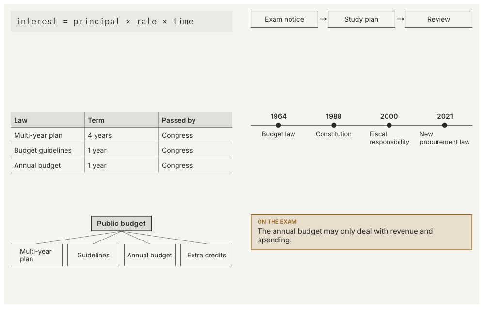
</p>

## Teachers & voices

Choose who teaches: **Helen**, **Lucy**, **Richard** or **Oliver** (in Portuguese: Helena,
Lia, Rafael and Otávio).
Ink portraits that breathe, blink, nod while you talk and move their lips with the voice:
human enough to talk to, drawn enough to stay out of the uncanny valley.

Ten voices, half of them female, from **Piper** and **Kokoro**, all running locally,
plus four English voices for English passages (US and UK accents).

<p align="center">
  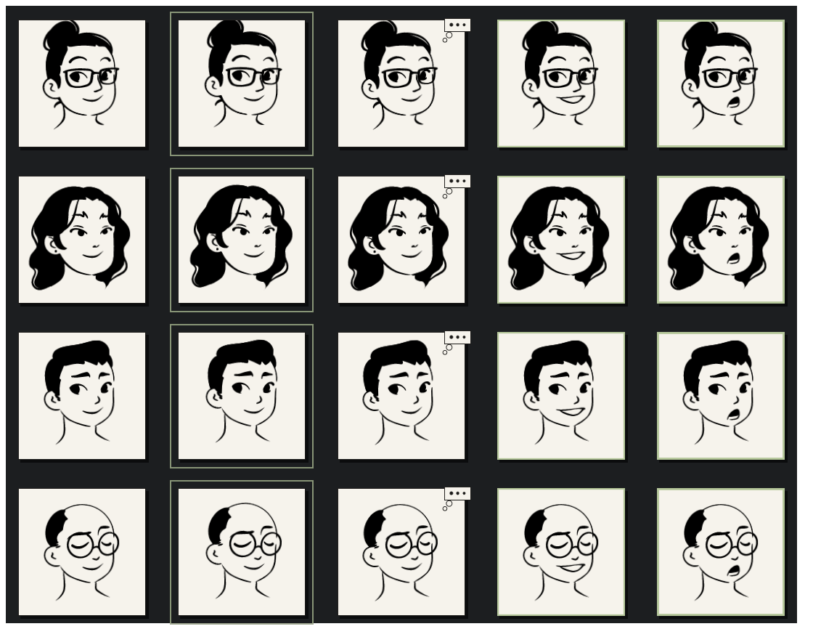
</p>

## Read and highlight your handouts

Generated handouts open right inside the app, page by page, exactly as their PDF.
Drag over a passage to highlight it, click it to write a note, and find every
highlight in the side list. Jump through the contents, type a page, grab the page to
move it, or click the mouse wheel to scroll on its own. Caderna remembers where you
stopped and how much of each handout you have read, and saves a PDF with your
highlights when you want one.

<p align="center">
  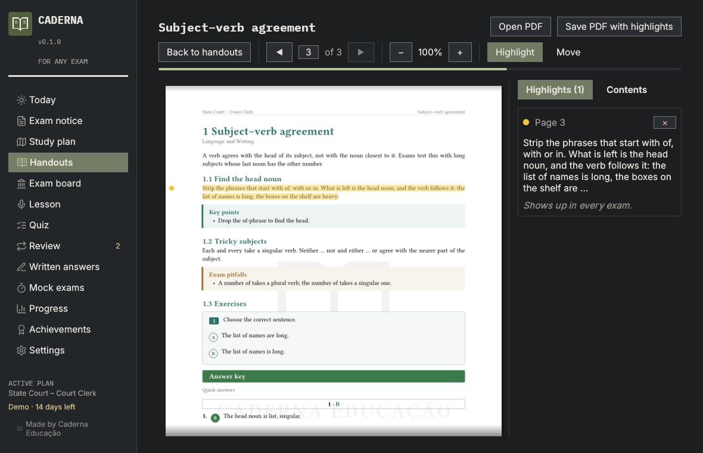
</p>

## Practice, review, handouts

- **Quizzes** in the style of the exam, with explanations; real past questions
  when you upload past exams.
- **Mistakes notebook**: every question you miss is kept until you get it right; it
  opens the next quiz on the topic and the teacher goes over it in the lesson.
- **Spaced review (SM-2)**: topics come back right before you would forget them, as
  three questions read aloud that you can answer by speaking.
- **Past exams and material**: past exams (with their answer key, in the same file or
  another one) and handouts, filtered against your
  syllabus, with the reason for whatever is set aside.
- **Handouts** per topic, subject or plan, with pictures, exercise cards and an
  answer key, saved as PDF.
- **Progress** per subject and **daily study time** that only counts active study.

## Mock exams

A whole exam in the notice's format, against the clock. **Read from the notice** finds how
many questions each subject has, the time, multiple choice or true/false, whether a wrong
answer cancels a right one and whether there is an essay; the app checks those numbers
against the notice's text and you can adjust any of them. **Generate a mock exam** writes
new questions in the exam board's style for every section, spread over the plan's topics
(past exams you added guide the style), and an essay proposal when the notice has a written
test.

Take it **on screen**, with the clock in the corner, or **print it**: a PDF with the
question booklet in two columns, a numbered essay sheet and an answer card with corner
markers. Doing it on paper, you copy your marks into the app's answer card and hand in. The
clock keeps going if you leave or close the app, and only one sitting runs at a time. The
grade is plain arithmetic on the saved key, per subject and with the notice's points: right,
wrong, blank, time used and whether you went over time. Missed questions go to your mistakes
notebook, the essay goes to Written answers to be photographed and graded, and the answer key
with explanations opens below. Ten new challenges come with it.

<table>
  <tr>
    <td>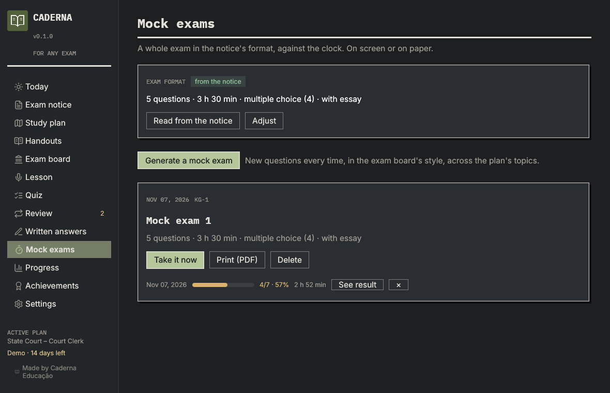</td>
    <td>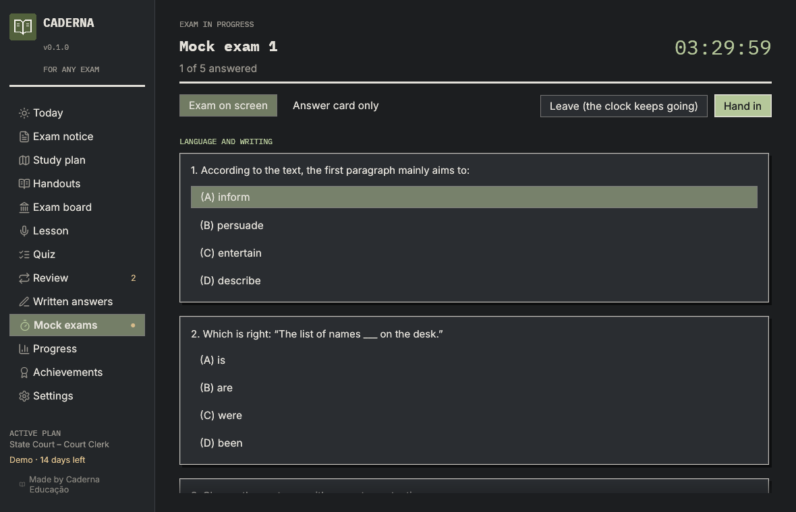</td>
    <td>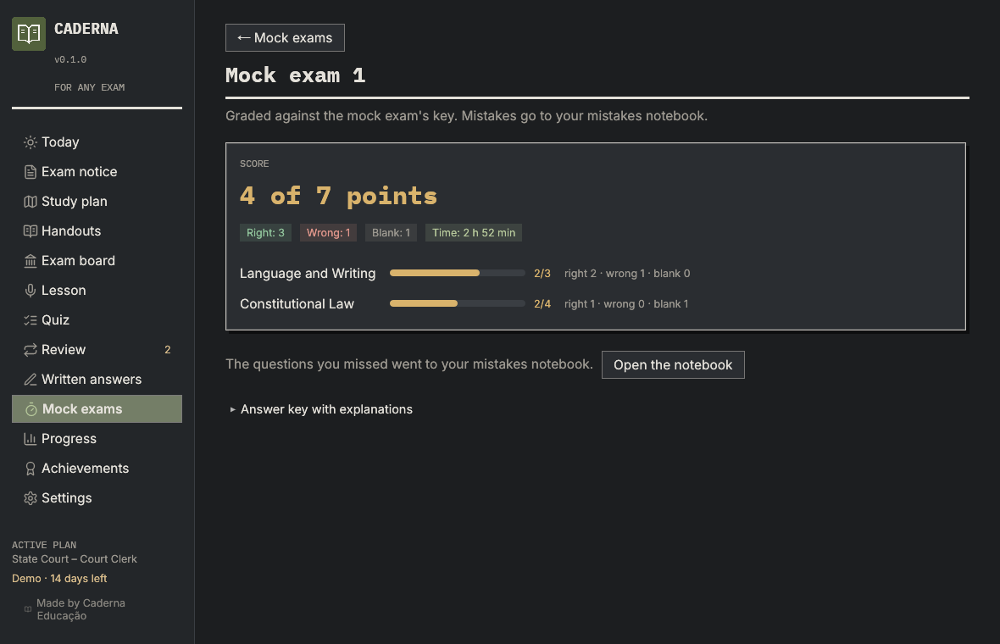</td>
  </tr>
</table>

## Challenges and achievements

The **Achievements** screen has **164 challenges** in 36 families, each level worth an
original achievement badge (jade, crescent moon, engraved like the app's mark). In each plan: lessons,
quizzes, right answers and perfect scores, missed questions won back, topics studied and
the share of the notice, plan weeks on track, topics and subjects mastered, reviews, past
exams, handouts and highlights, written answers when the notice has them, and mock exams. Across every
plan: study hours and days, plans made and the collection itself. First Step, Comeback, Plan in
Motion and Week on Track keep their own names.

Each family is one line: the next level, how far along you are (2/3), "level 3 of 11" and a
button to the lesson, quiz or review. Today shows the next one, quietly. The showcase has
every achievement, filtered by won or locked, with the details on hover; the level is the
rim's colour and one to three dots. Achievements are won only by rules in the code, from your
saved study, never by the AI; each plan keeps its own progress. Study from before this
feature counts too; when the history does not tell the day, the card says so. A short
notice appears after a lesson or quiz ends, never in the middle, and only once. No points,
no ranking, no streak to lose.

<table>
  <tr>
    <td>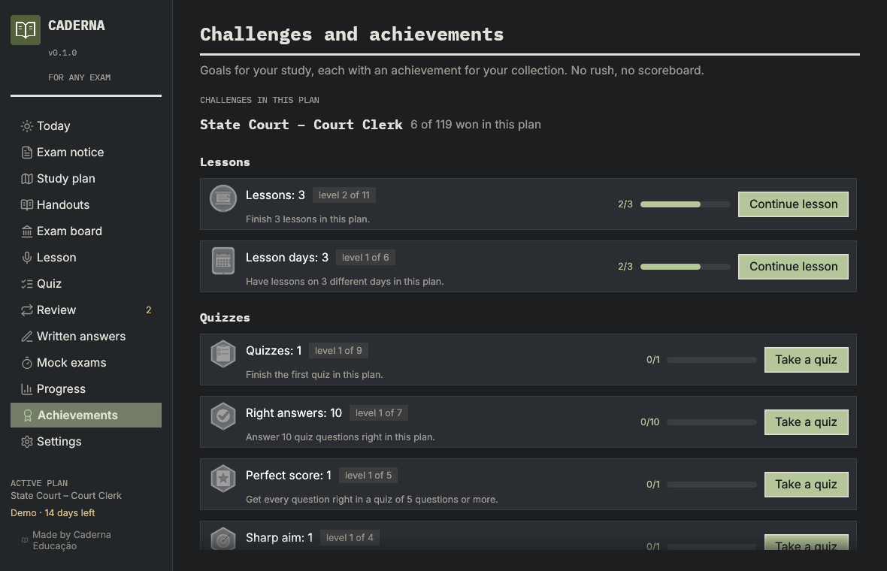</td>
    <td>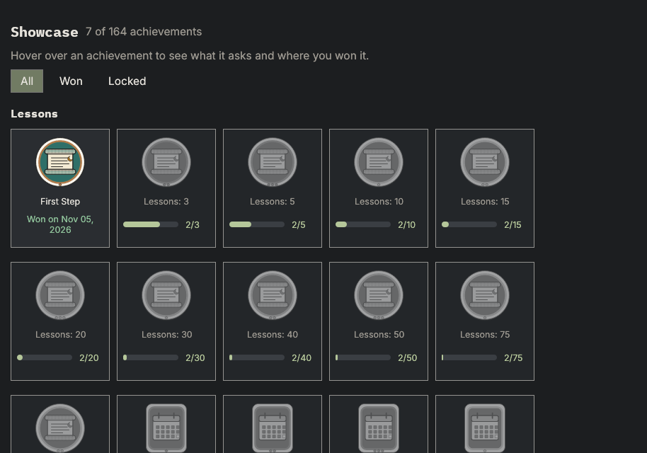</td>
  </tr>
</table>

## Written answers

When the exam notice has an essay or a discursive test, a **Written answers** area
appears. It never appears for a notice without one. A plan made before can have its
notice read again (**Re-read notice**) without losing topics, progress or handouts.

- **Prompts from your plan**: an argumentative essay, a technical discursive question or
  a case study, on topics you pick or on what you studied and missed. The criteria and
  points are shown before you write: the notice's own (with the passage quoted), yours,
  or Caderna's generic ones, clearly labelled. The answer outline stays hidden until
  you hand in.
- **Write by hand, send photos**: JPEG or PNG pages, rotated, reordered, replaced or
  removed before sending. Dark, blurry or cut-off photos are flagged and you are asked
  for a new one instead of getting a grade.
- **Check the reading**: photo and transcript side by side. Your spelling and errors are
  kept; uncertain words are marked and never count against you. Fixing the reading is
  kept apart from the model's original; rewriting your answer becomes a new version.
- **Formative grade**: an estimated score per criterion and in total (summed by the app),
  with quotes that are checked against your text, strengths, problems with suggestions,
  three priorities and topics to review. Then the answer outline.
- **Progress**: scores by criterion across attempts graded on the same rubric, photo
  reading problems apart from writing and content ones, and recurring difficulties with
  examples from your own attempts.

By default, PaddleOCR-VL 1.5 (0.9B) reads photos locally through the bundled
[🦙 llama.cpp](https://github.com/ggml-org/llama.cpp) `llama-server` v0.8.0 runtime; its
first model download is about 1.82 GB from Hugging Face. In Settings → AI, you can explicitly
choose the configured vision API instead, which sends the photos to that provider.
Copilot is text-only, so it always uses local OCR. **Test image reading** checks the
selected backend. One photo can hold one page or an open notebook with two pages side by
side. Minimum hardware and handwriting accuracy have not yet been benchmarked; review
every transcript before grading. Windows and Linux builds include a 🔺 [Vulkan](https://www.vulkan.org/)
runtime and use a detected supported GPU when available, falling back to CPU if no device is found or
GPU startup fails. macOS builds use CPU.
The Windows installer bundles the required C++ runtime and Vulkan loader; a compatible GPU
driver is still needed for Vulkan.
With a reasoning API model, keep **Fast responses** on so a dense page is not lost to long
reasoning.

<table>
  <tr>
    <td>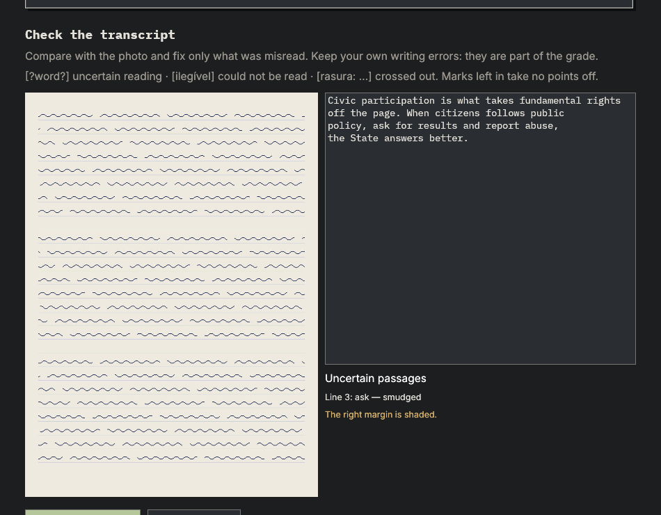</td>
    <td>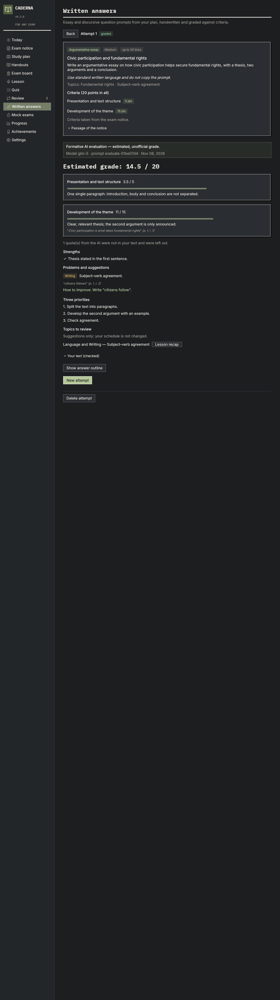</td>
  </tr>
</table>

<table>
  <tr>
    <td>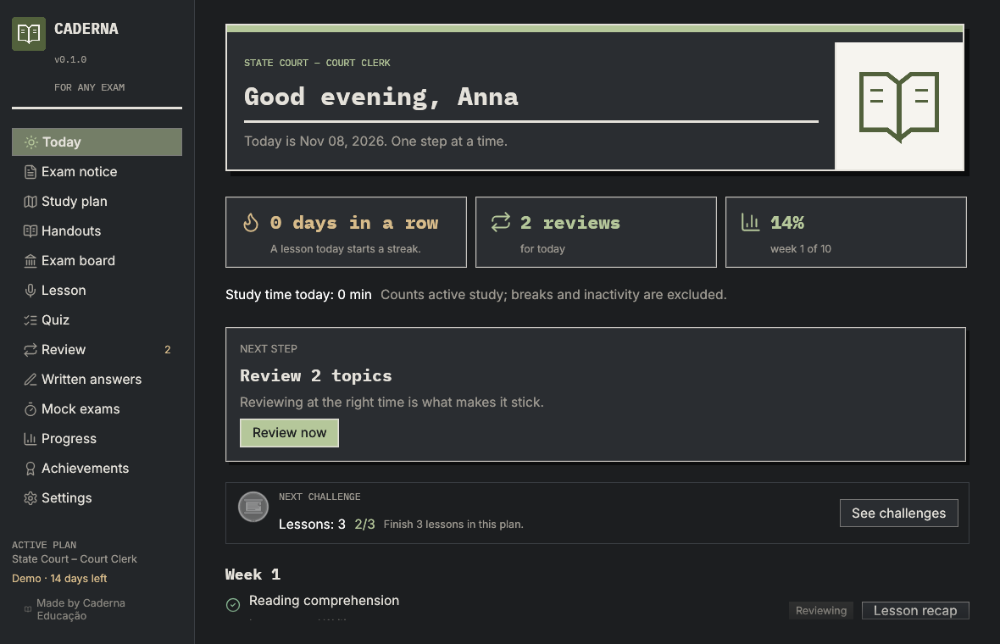</td>
    <td>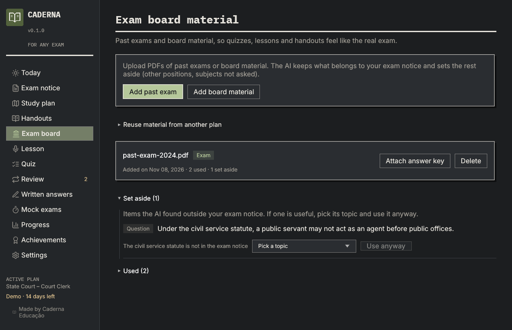</td>
  </tr>
</table>

## First run

Five short steps before anything else: language, your name, a teacher, your AI service and
its API key or account sign-in, and the terms. Pick from 22 providers with their logos:
**Z.ai** is recommended for value and **Claude** for accuracy, each with a link to create
a key. Load the models your key can use, or type any model name. A short tour of the
screens follows. Plans made before are kept.

GitHub Copilot can be connected with your GitHub account through the official Copilot CLI,
without an API key. The CLI normally stores sign-in credentials in the operating system
keychain; if it is unavailable, the CLI may use a plain-text config file
(`~/.copilot/config.json`). Caderna does not save the credentials in its database.
Copilot in this integration accepts text, not images.

**Sign in with an account you already have.** The AI step opens on *Sign in with an account*, for people who pay for a chat plan and have never made an API key: **ChatGPT** (OpenAI's official *Sign in with ChatGPT*: lessons count toward your ChatGPT plan), **Claude** (through Claude Code, Anthropic's official program, signed in with your Claude Pro or Max account; Caderna can install it for you) and **GitHub Copilot**. Each one signs in on its owner's page; Caderna never sees your password. Caderna is not affiliated with OpenAI, Anthropic or GitHub.

<p align="center">
  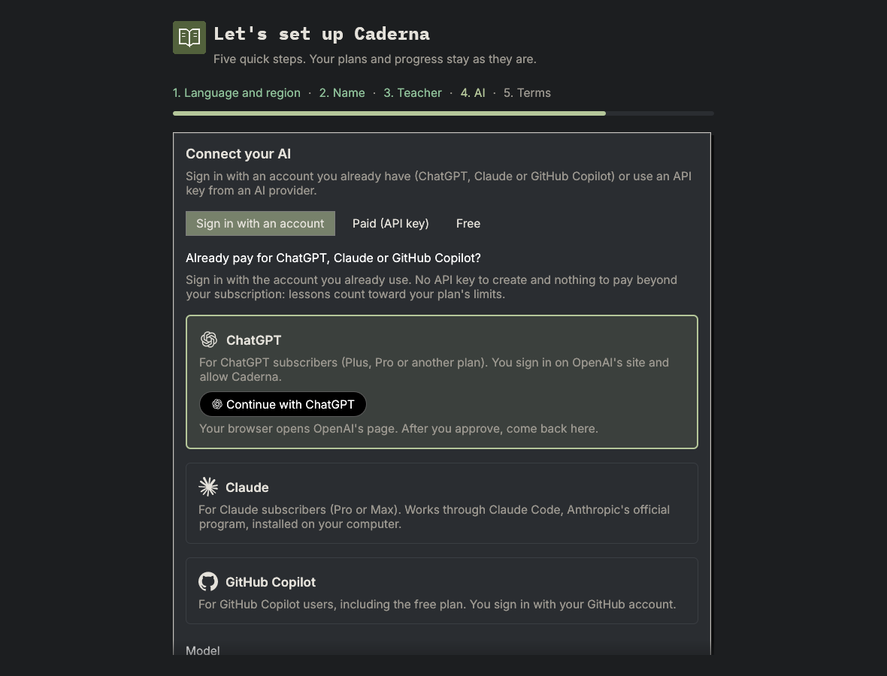
</p>

**Free or paid.** Besides *Sign in with an account*, the AI step has two more tabs. *Paid* shows the recommended services (Z.ai for
value, Claude for accuracy). *Free* lists services with a free plan (Gemini, Mistral,
OpenRouter, Groq, NVIDIA, GitHub Models, and Ollama or LM Studio on your own computer), each
with the model the plan covers, what it does with what you send (some free plans train on
it) and a link to its limits and rules.

**Your region's way of studying.** Lessons, quizzes, handouts and written answers follow
how people prepare for exams where you live: in Brazil, Cebraspe true/false items and
five-option questions from FCC and FGV, and an essay counted in lines; in Japan, five-option
questions and a 小論文 counted in characters; in mainland China, the 行测 and the 申论; in
Taiwan and Hong Kong, their civil service formats; in the US and UK, standardized tests, the
bar and mark schemes. The exam notice and past exams always come first.

<p align="center">
  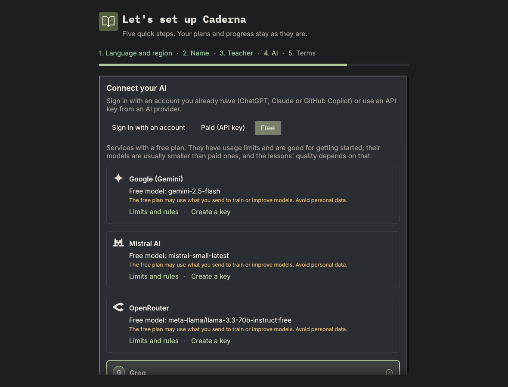
</p>

<table>
  <tr>
    <td>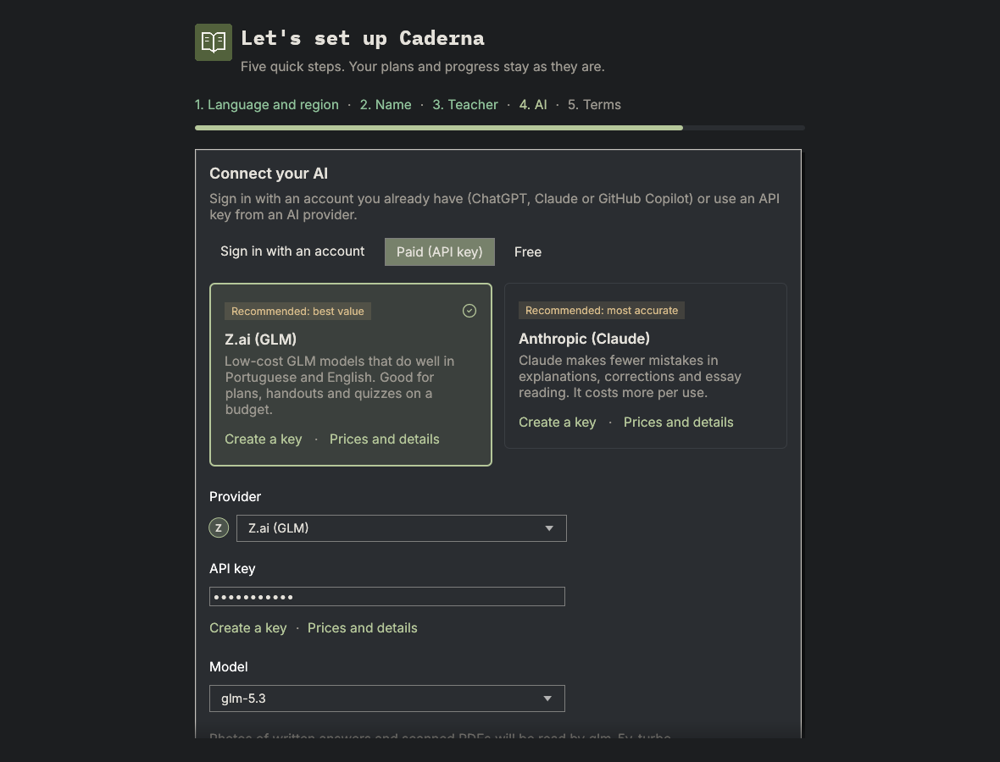</td>
    <td>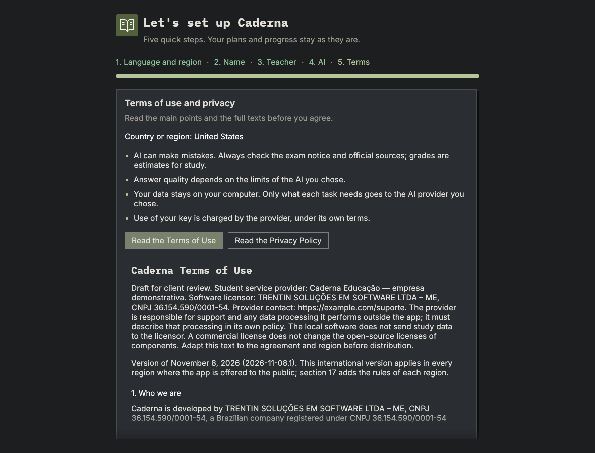</td>
  </tr>
</table>

<p align="center">
  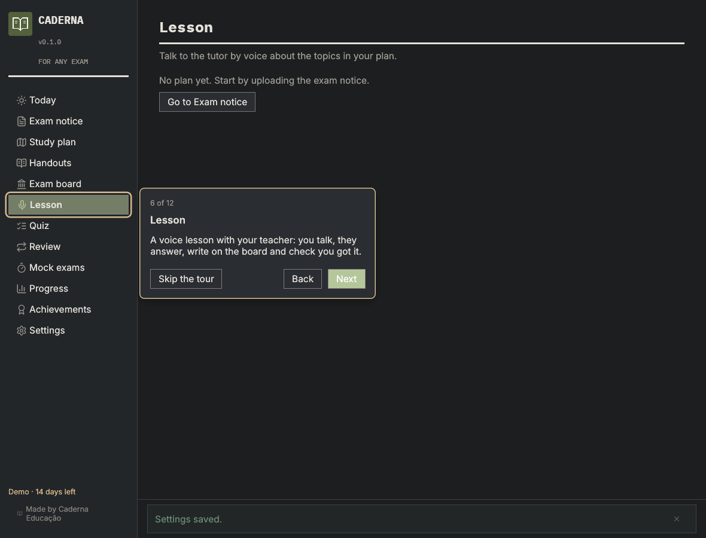
</p>

## Private by default

- Speech recognition and the voices run on your machine. Recordings never leave it.
- Your data (SQLite database, models, log) lives in `%LOCALAPPDATA%\<data_dir>` (`KnowGiver` for Know Giver itself), or in
  `KG_DATA_DIR` when set.
- Handwritten photos are read locally by default and stay on this computer. If you
  explicitly choose the external vision API in Settings → AI, photos are sent to that
  provider; Copilot always uses local OCR. The app says where before sending; photos stay
  in your data folder and are deleted with their attempt. Logs never hold images, answers
  or keys. Scanned-PDF pages are sent to the configured vision model only when you request
  their OCR. Installing local OCR downloads about 1.82 GB from Hugging Face.
- When the brand names a release repository, the app asks GitHub for the latest version
  when it opens; only that request is sent, and Settings → About and updates turns it off.
  Brands without one never check.
- No account, telemetry or ads. Read the [Terms of Use](docs/legal/terms-of-use.en.md) and
  the [Privacy Policy](docs/legal/privacy-policy.en.md) (EU, UK and US), also shown in the
  app.

## White-label builds

This repository is the **white-label base** of Know Giver: the same app, built with
another company's name, colours and pictures, and optionally as a **time-limited
demonstration**. There are no public releases here; each build is made for one client.

**1. Create the brand.** Copy `branding/example` to `branding/<client>` and edit
`brand.toml`:

| Section | What it sets |
| --- | --- |
| `[app]` | product name, `slug` (window id, database name), `data_dir` (data and install folder), installer GUID |
| `[company]` | company name, site, "Made by …" credit on/off, licence of the mark |
| `[colors]` | accent and highlight (light and dark themes), handout credit colour |
| `[assets]` | app icon (PNG and ICO), cover art, reminder art, mark (SVG) and handout watermark (SVG) |
| `[updates]` | GitHub repository with the client's releases, or empty for no update checks |
| `[demo]` | `enabled`, `days` from the first start, `expires` (last day), contact link |
| `[company]` extras | `support_url` (Settings → About), `teachers_dir` and `stickers_dir` to replace the bundled art |
| `[legal]` | folder with the brand's 15 legal texts, consent `version`, provider, licensor, contact, review flags |
| `[licensing]` | Ed25519 **public** key for licence keys, and `required` to stop without one |

**2. Build.** The brand is read at compile time from `KG_BRAND_DIR` (default
`branding/default`, which is Know Giver itself):

```powershell
powershell -ExecutionPolicy Bypass -File scripts\package.ps1 -Brand branding\<client>
```

This creates `dist\<data_dir>-<version>-windows-x64.zip` and, with
[Inno Setup 6](https://jrsoftware.org/isinfo.php), `dist\<data_dir>-<version>-setup.exe`,
both with the client's name and icon. For a quick run:
`$env:KG_BRAND_DIR = "branding/<client>"; cargo run --release`.

**Demonstration builds.** With `[demo] enabled = true`, the app counts `days` from its
first start and/or stops after `expires`, whichever comes first. The sidebar shows the
days left; when the time is over, only a "demonstration ended" screen opens, with a
button to the client's contact link. Plans and progress stay on the computer. The first
start and the latest day used are kept in the database and in the system settings folder,
so deleting one of them or turning the clock back does not restart the demonstration.
It is a commercial deterrent, not copy protection.

**Licences and legal texts per brand:** a brand can carry an Ed25519 public key; the
client's students then activate a licence key (offline, bound to the brand, customer,
seats and dates) in Settings or on the "demonstration ended" screen, and study data is
never touched. The brand can also bring its own terms and privacy policy, support link,
teacher portraits and stickers. Packaging for sale refuses to run until the brand's
legal and commercial review flags are set. See [branding/README.md](branding/README.md);
what is still open is in the [ROADMAP](ROADMAP.md). Check the licences under
[Credits](#credits) before selling a build.

**Caderna.** `branding/caderna` is the first client brand: paper, graphite and olive,
its own icon, cover and marks, a 14-day demonstration and its Ed25519 public key. Its
legal texts are drafts (`[legal] reviewed = false`), so packaging it for sale stays
blocked until they are reviewed. Run it with
`$env:KG_BRAND_DIR = "branding/caderna"; cargo run --release`; each brand keeps its own
data folder, so it never mixes with an installed Know Giver.

**Issuing licences.** Keys are made once per brand and the private key never enters the
repository:

```sh
cargo run -p kg-engine --example license_issue -- keygen private.pk8 public.txt
cargo run -p kg-engine --example license_issue -- sign private.pk8 claims.json license.txt
```

**CADERNA-DASHBOARD.** A separate Laravel and Filament project is the Caderna panel:
clients are validated there, each client's colours, images and texts are set, and
evaluation tokens and licences are issued in the same format the app verifies offline.
It also runs an OpenAI-compatible AI gateway whose provider keys stay on the server, and
runs with Docker or a local PHP install ([czarist/caderna-dashboard](https://github.com/czarist/caderna-dashboard)). The
app does not connect to it yet: online activation, downloading the brand and using AI
through the panel are planned ([ROADMAP](ROADMAP.md), Phase W6) and will be described in
the privacy policy before they ship.

## Quick start

```bash
cargo run --release
```

The first run asks for five things before anything else opens: language, your name, a
teacher, the AI service and your key, and agreement to the terms. Pick the provider and
the model from the list (**Z.ai** is recommended for value, **Claude** for accuracy, each
with a link to create a key), or load the models your key can use. A short tour of the
screens follows. Plans made before are kept.

Closing the window keeps the app in the system tray: double-click the icon to reopen it, or click it once for the menu (open or quit). Opening Caderna again while it runs brings back the same window; there is only ever one copy and one tray icon. During installation, you can choose whether it starts with the system and whether to receive study reminders (every 3 hours by default, from 30 minutes to 8 hours in Settings); both are off by default. The reminder is a small Caderna window in the corner of the screen, with the subjects furthest behind and a button to start studying. Reminders come while you are away from the app (in the tray, minimized or behind other windows), not during a lesson, quiz or review, and only while the active plan has unfinished subjects.

For development, `.env` (copy `.env.example`) can still set the endpoint and models;
`.env` overrides global variables with the same name. Download the speech models in
Settings. Rust 1.95 or newer.

**Windows package:** see [White-label builds](#white-label-builds)
(`scripts\package.ps1 -Brand branding\<client>`).

## Development

```
crates/
  app/      # know-giver binary (entry point, branded icon and version info)
  brand/    # kg-brand: the build's brand, read from brand.toml at compile time
  ui/       # egui interface (screens, theme, translations)
  engine/   # app state, commands, background work, voice loop
  study/    # plans, reviews (SM-2), quizzes, SQLite storage
  ai/       # OpenAI-compatible client, Copilot SDK adapter + prompts
  audio/    # mic capture, Parakeet/Whisper STT, Piper/Kokoro TTS, playback, downloads
  pdf/      # edital text extraction, roles
  handout/  # study handouts rendered to PDF with Typst
locales/    # UI translations (pt-BR, en, ja, zh-Hans, zh-Hant)
branding/   # brand folders: default (Know Giver), example (template), caderna (client)
tools/      # artwork generators (icon, teacher portraits)
```

Dependencies point one way: `app → ui → engine → {study, ai, audio, pdf, handout}`;
`kg-brand` sits under all of them.
See [docs/architecture.md](docs/architecture.md).

```bash
cargo fmt
cargo clippy --workspace --all-targets -- -D warnings
cargo test --workspace
```

Builds use every CPU core (Cargo's default). To limit one run, pass `-j N`. A local,
git-ignored `.cargo/config.toml` can pick the brand for plain `cargo run`:
`[env] KG_BRAND_DIR = { value = "branding/caderna", relative = true }`.

Manual checks against real services (need `.env` and network):

```bash
cargo run -p kg-ai --example live_check                          # every AI task (KG_PROMPT_LANG=en for English prompts)
cargo run -p kg-engine --example e2e -- edital.pdf                # import → plan → quiz → review → handout
cargo run --release -p kg-audio --example parakeet_check -- <models-dir> fala.wav
KG_SNAPSHOT_DIR=shots cargo test -p kg-ui snapshots -- --ignored  # renders every screen to PNG
```

More: [native/CUDA builds](docs/builds.md), [Kokoro evaluation](docs/kokoro-evaluation.md),
[validation notes](docs/validation-v0.15.md),
[written answers manual check](docs/validation-discursive.md).

## Credits

- App icon and cover art: Thoth as a baboon under the crescent moon, on a jade tile, by
  [Cezar Trentin](https://cezartrentin.dev) (`crates/ui/assets/art/thoth-tile.png`);
  `python tools/icon.py` builds the app and Windows icons from it.
- Caderna icon, cover, reminder art and marks (`branding/caderna`): original artwork
  made for the Caderna brand, under the project's license.
- Fonts: [Inter](https://rsms.me/inter/) and [IBM Plex Mono](https://github.com/IBM/plex),
  SIL Open Font License (`crates/ui/assets/fonts`).
- Teacher portraits (`crates/ui/assets/teachers`): "Lorelei" by Lisa Wischofsky,
  CC0 1.0, through [DiceBear](https://www.dicebear.com/styles/lorelei/); rebuilt with
  `python tools/teachers.py`.
- Whiteboard pictures are shown from [Wikipedia](https://pt.wikipedia.org); the
  caption names the article, where each picture's author and license are listed.
- Icons: [Lucide](https://lucide.dev), ISC license (`crates/ui/assets/icons`).
- Achievement badges (`crates/ui/assets/stickers`): original SVGs made for Know Giver,
  under the project's license.
- AI provider logos: [Simple Icons](https://simpleicons.org), CC0 (`crates/ui/assets/providers`);
  the logos are trademarks of their owners, shown only to identify each service.

## License

Licensed under either of [MIT](LICENSE-MIT) or [Apache License 2.0](LICENSE-APACHE), at your
option (`MIT OR Apache-2.0`). Unless you state otherwise, any contribution you submit for
inclusion is dual-licensed the same way, without additional terms.

Third-party fonts, portraits and voices keep their own licenses, listed under
[Credits](#credits). To report a vulnerability, see [SECURITY.md](SECURITY.md).
