<p align="center">
  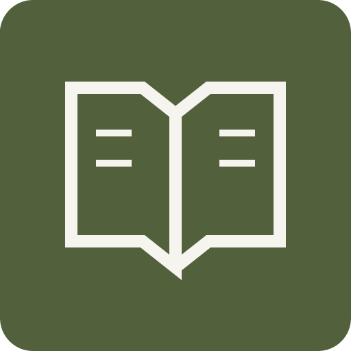
</p>

<h1 align="center">Caderna</h1>

<p align="center"><b>Feito sobre a base white-label do Know Giver</b></p>

<h3 align="center">Sua prova. Seu plano. Um professor que conversa com você.</h3>

<p align="center">
  <a href="README.md">English</a> · <a href="README.pt-BR.md">Português (Brasil)</a> · <a href="README.ja.md">日本語</a> · <a href="README.zh-Hans.md">简体中文</a> · <a href="README.zh-Hant.md">繁體中文</a>
</p>

<p align="center">
  <b>Um app de desktop que monta planos de estudo para provas, feito em Rust puro.</b><br>
  Envie o programa da prova (edital de concurso ou da OAB, matriz do ENEM, manual do vestibular), receba um plano semana a semana e estude em voz alta com um tutor que escuta, explica e faz perguntas.
</p>

<p align="center">
  <a href="https://www.rust-lang.org"></a>
  <a href="https://github.com/emilk/egui"></a>
  <a href="https://www.sqlite.org"></a>
  <a href="https://typst.app"></a>
  
  <a href="https://github.com/rhasspy/piper"></a>
  
  
  <a href="https://github.com/ggml-org/llama.cpp"></a>
  <a href="https://www.vulkan.org/"></a>
  
  
  
  <a href="#license"></a>
  
  
</p>

<br>

<p align="center">
  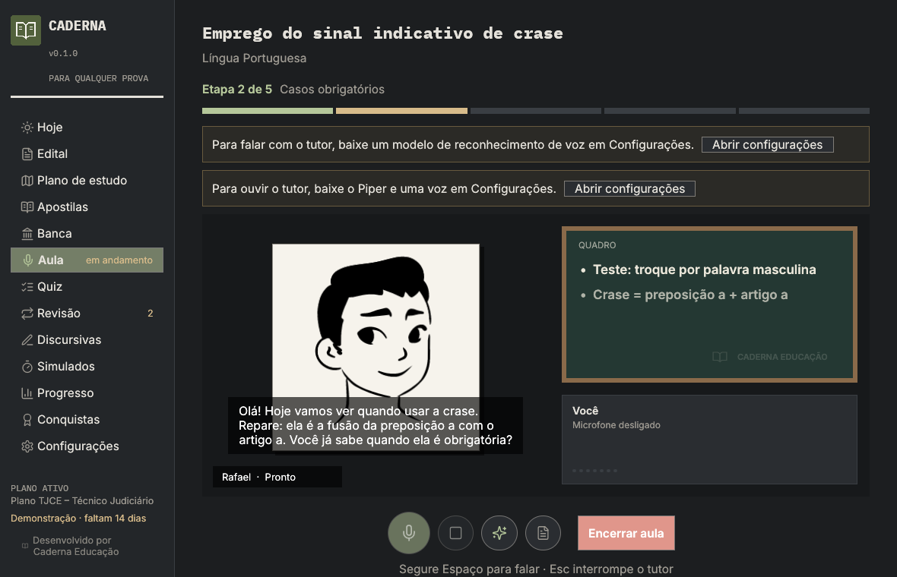
</p>

<p align="center">
  <a href="#do-programa-ao-plano">Programa → plano</a> ·
  <a href="#aulas-por-voz">Aulas por voz</a> ·
  <a href="#um-quadro-que-mostra-não-só-fala">Quadro</a> ·
  <a href="#professores-e-vozes">Professores</a> ·
  <a href="#leia-e-destaque-suas-apostilas">Leitor</a> ·
  <a href="#prática-revisão-e-apostilas">Prática</a> ·
  <a href="#discursivas">Discursivas</a> ·
  <a href="#primeiro-acesso">Primeiro acesso</a> ·
  <a href="#privado-por-padrão">Privacidade</a> ·
  <a href="#começo-rápido">Começo rápido</a> ·
  <a href="#desenvolvimento">Desenvolvimento</a>
</p>

<br>

## Do programa ao plano

O programa da prova é lido no seu computador; só o conteúdo programático vai para a IA.

- **Escolha o cargo.** Alguns editais têm vários cargos. O Caderna encontra todos e
  pergunta para qual você vai concorrer, então o plano traz as matérias comuns e só as
  específicas do *seu* cargo.
- **Sua rotina.** O número de semanas e de horas por semana define um plano por semana,
  matéria e tópico. Dá para manter várias provas lado a lado.
- **PDF escaneado.** Páginas sem texto podem ser transcritas por um modelo de visão que
  você configura.

<p align="center">
  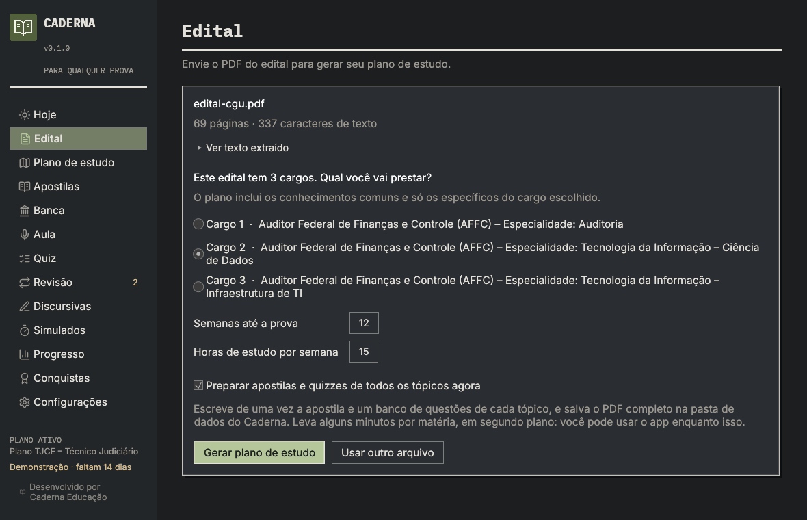
</p>

## Aulas por voz

Você fala e o tutor responde em voz alta, como numa chamada com um professor paciente.

### 🎙️ Escuta
Reconhecimento de fala local: **Parakeet** para as legendas ao vivo enquanto você fala e
**Whisper** como segunda opinião em respostas curtas ou duvidosas. O microfone fica aberto
a aula toda, vozes baixas são amplificadas antes do reconhecimento, e a sua vez termina
depois de uma pausa que você escolhe nas Configurações, para dar tempo de pensar numa
palavra.

### 🗣️ Fala
O tutor começa a falar já na primeira frase da resposta, diz "Hum." enquanto pensa e para
quando você interrompe. As legendas acompanham a voz, frase a frase. Mãos livres, apertar
para falar (Espaço) ou digitando.

### 🧭 Uma aula com começo e fim
Cada aula segue um roteiro feito a partir da apostila do tópico (ou escrito pelo
professor): cada etapa traz os pontos-chave da apostila, o professor confere se você
entendeu antes de seguir, e tudo o que o quiz vai perguntar é visto no caminho. Você sempre
sabe onde está ("Etapa 2 de 5"), e a aula fecha com um resumo e o convite para o quiz.
Escolha aulas **Rápida**, **Normal** ou **Completa** nas Configurações. Aulas feitas ganham
um visto no plano e guardam o roteiro, o quadro e o fechamento para rever depois. Saiu no
meio? **Continuar aula** retoma de onde parou. Palavras e frases em inglês podem ser lidas
por uma voz em inglês.

### 🧠 Ensino
Qualquer modelo compatível com a API da OpenAI (Ollama, LiteLLM, GLM, …) por trás de prompts
de tutor escritos para conversa falada: falas curtas, uma ideia por vez, perguntas de volta
para você. Os prompts seguem o idioma do app: português por padrão, inglês quando o app está
em inglês.

## Um quadro que mostra, não só fala

Além dos pontos-chave, o tutor escreve **fórmulas**, **diagramas**, **tabelas
comparativas**, **linhas do tempo**, **mapas mentais**, **dicas de prova** e **exemplos
resolvidos**, e mostra **imagens** da Wikipédia (só o termo de busca sai do seu
computador).

<p align="center">
  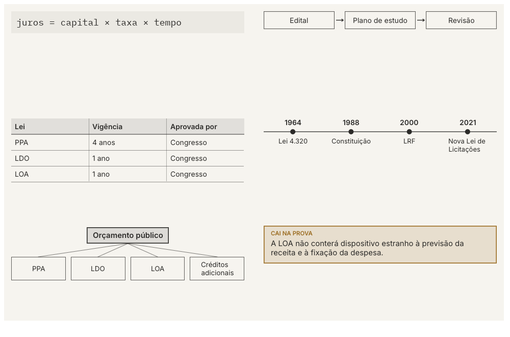
</p>

## Professores e vozes

Escolha quem dá a aula: **Helena**, **Lia**, **Rafael** ou **Otávio**.
Retratos a nanquim que respiram, piscam, acenam com a cabeça enquanto você fala e mexem os
lábios com a voz: humanos o bastante para conversar, desenhados o bastante para não
causar estranheza.

Dez vozes, metade femininas, do **Piper** e do **Kokoro**, todas rodando no seu
computador, mais quatro vozes em inglês para trechos em inglês (sotaques americano e
britânico).

<p align="center">
  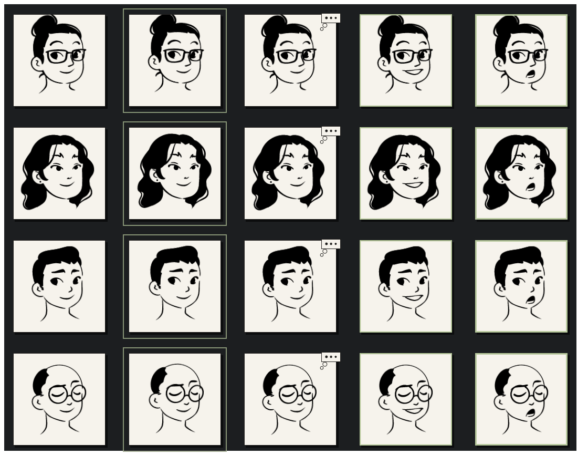
</p>

## Leia e destaque suas apostilas

As apostilas geradas abrem dentro do app, página por página, exatamente como o PDF.
Arraste sobre um trecho para destacar, clique nele para escrever uma nota e encontre todos
os destaques na lista lateral. Navegue pelo sumário, digite uma página, arraste a página
para movê-la ou clique com a rodinha do mouse para rolar sozinho. O Caderna lembra onde
você parou e quanto já leu de cada apostila, e salva um PDF com os seus destaques quando
você quiser.

<p align="center">
  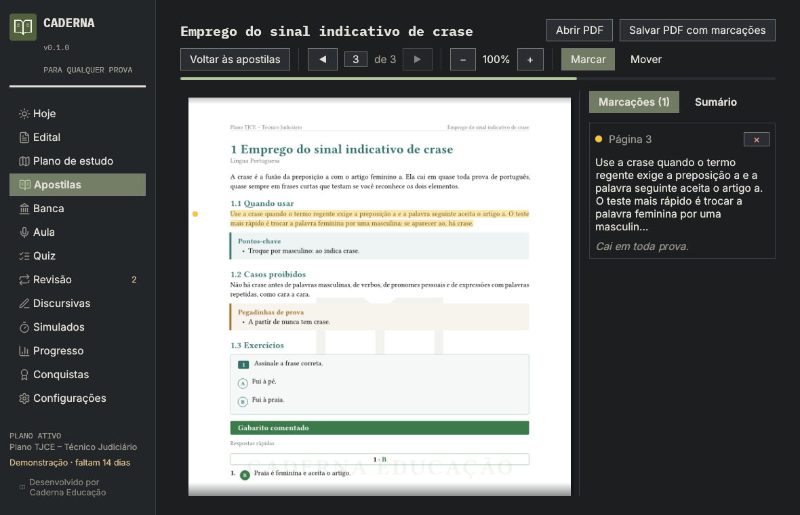
</p>

## Prática, revisão e apostilas

- **Quizzes** no estilo da banca, com explicações; questões reais de provas anteriores
  quando você as envia.
- **Caderno de erros**: toda questão que você erra fica guardada até você acertar; ela abre
  o próximo quiz do tópico e o professor a retoma na aula.
- **Revisão espaçada (SM-2)**: os tópicos voltam pouco antes de você esquecer, como três
  perguntas lidas em voz alta que você pode responder falando.
- **Provas anteriores e material**: provas anteriores (com gabarito, no mesmo arquivo ou
  em outro) e apostilas da banca, filtradas pelo seu conteúdo programático, com o motivo
  de tudo o que fica de fora.
- **Apostilas** por tópico, matéria ou plano inteiro, com imagens, cartões de exercícios e
  gabarito, salvas em PDF.
- **Progresso** por matéria e **tempo de estudo diário**, que conta só o estudo ativo.

## Simulados

Uma prova inteira no formato da sua, com tempo marcado. **Ler do programa** encontra
quantas questões cada matéria tem, o tempo, se é múltipla escolha ou certo/errado, se uma
errada anula uma certa e se há redação; o app confere esses números no texto do programa e você
pode ajustar qualquer um. **Gerar simulado** escreve questões novas no estilo da banca para
cada matéria, distribuídas pelos tópicos do plano (as provas anteriores que você adicionou
guiam o estilo), e um tema de redação quando o programa prevê prova discursiva.

Faça **na tela**, com o relógio no canto, ou **imprima**: um PDF com o caderno de questões em
duas colunas, a folha de redação com linhas numeradas e o cartão-resposta com marcadores nos
cantos. Fazendo no papel, você passa as marcações para o cartão-resposta do app e entrega. O
relógio continua se você sair da tela ou fechar o app, e só uma prova corre por vez. A nota é
conta simples sobre o gabarito salvo, por matéria e com os pesos do programa: certas, erradas,
em branco, tempo usado e se passou do tempo. As erradas vão para o caderno de erros, a redação
vai para as Discursivas para ser fotografada e corrigida, e o gabarito comentado abre logo
abaixo. Vêm junto dez desafios novos.

<table>
  <tr>
    <td>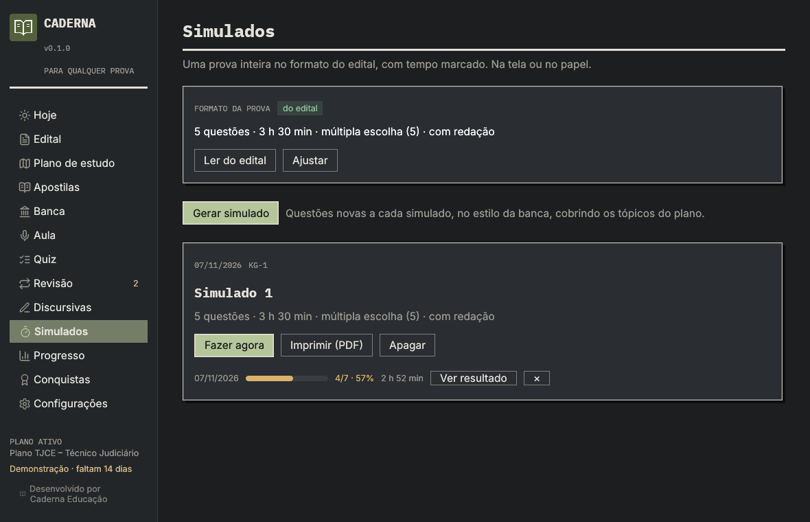</td>
    <td>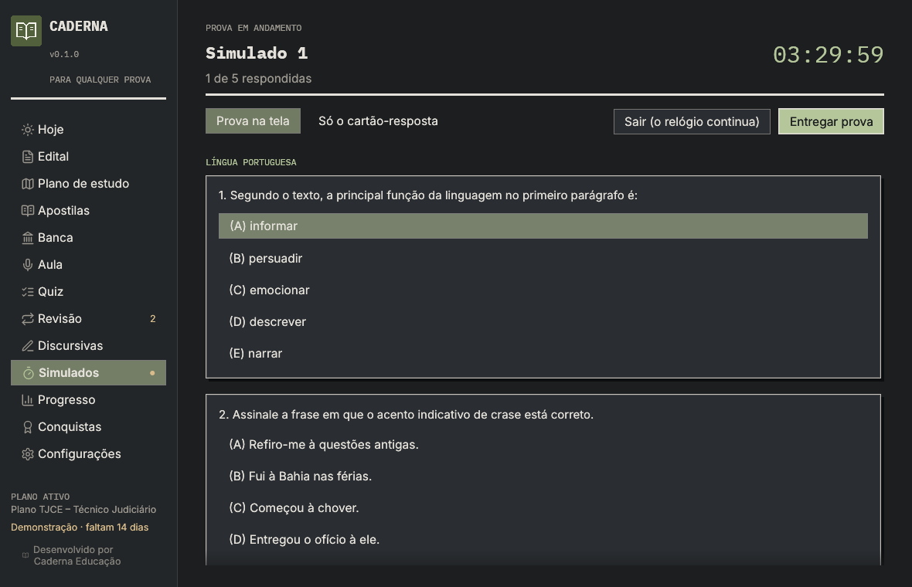</td>
    <td>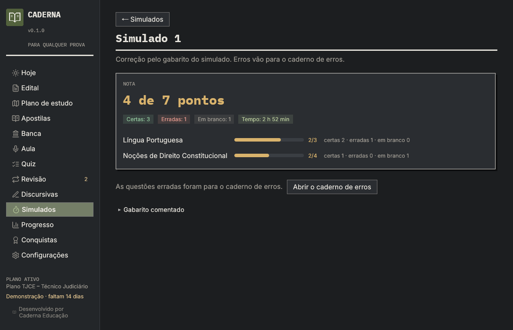</td>
  </tr>
</table>

## Desafios e conquistas

A tela **Conquistas** tem **164 desafios** em 36 famílias, e cada nível vale uma conquista
original (jade, lua crescente, gravura como a marca do app). Em cada plano: aulas, quizzes,
acertos e gabaritos perfeitos, questões erradas recuperadas, tópicos estudados e a parte do
programa coberta, semanas do plano em dia, tópicos e matérias dominados, revisões, provas
anteriores, apostilas e destaques, e discursivas quando o programa tem. Somando todos os planos:
horas e dias de estudo, planos criados e a própria coleção. Primeiro Passo, Volta por Cima,
Plano em Movimento e Semana em Dia têm nome próprio.

Cada família é uma linha: o próximo nível, quanto falta (2/3), "nível 3 de 11" e um botão
para a aula, o quiz ou a revisão. A tela Hoje mostra o próximo, com discrição. A vitrine tem
todas as conquistas, com filtro de obtidas e bloqueadas e os detalhes ao passar o mouse;
o nível aparece na cor do aro e em um a três pontos. As conquistas vêm só de regras no
código, a partir do seu estudo salvo, nunca da IA; cada plano tem o próprio progresso. O
estudo de antes deste recurso também conta; quando o histórico não diz o dia, o cartão avisa.
Um aviso curto aparece depois que a aula ou o quiz termina, nunca no meio, e uma vez só. Sem
pontos, sem ranking, sem sequência a perder.

<table>
  <tr>
    <td>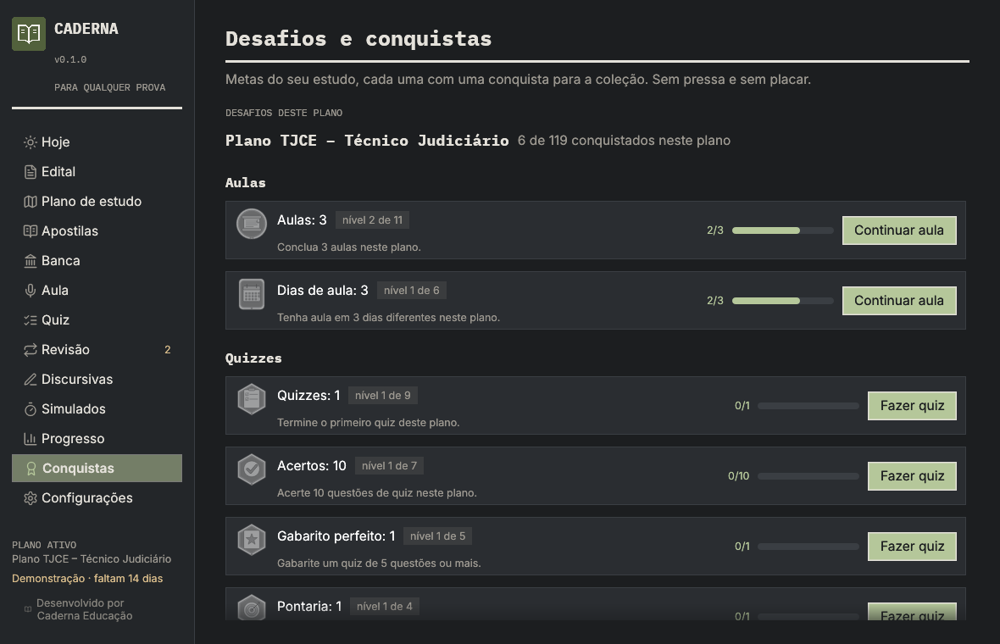</td>
    <td>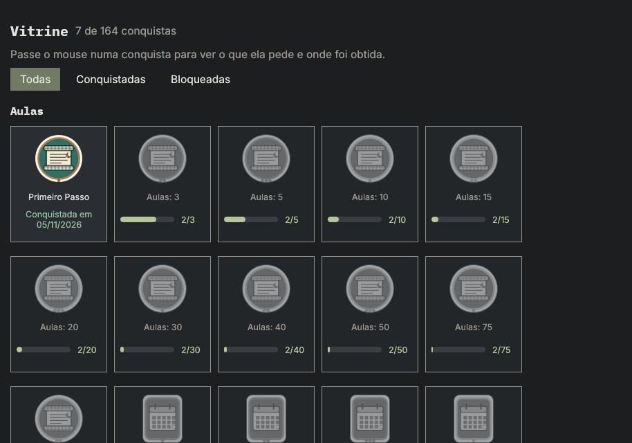</td>
  </tr>
</table>

## Discursivas

Quando o programa da prova tem redação ou prova discursiva, aparece a área **Discursivas**. Ela nunca
aparece para um programa sem essa prova. Um plano criado antes pode ter o programa lido de novo
(**Reler o programa**) sem perder tópicos, progresso ou apostilas.

- **Propostas a partir do seu plano**: redação dissertativa, questão discursiva técnica ou
  estudo de caso, sobre tópicos que você escolhe ou sobre o que você estudou e errou. Os
  critérios e a pontuação aparecem antes de você escrever: os do programa (com o trecho
  citado), os seus ou os genéricos do Caderna, sempre identificados. O padrão de
  resposta fica escondido até a entrega.
- **Escreva à mão e envie fotos**: páginas em JPEG ou PNG, que podem ser giradas,
  reordenadas, trocadas ou removidas antes do envio. Fotos escuras, borradas ou cortadas são
  sinalizadas, e o app pede uma nova em vez de dar nota.
- **Confira a leitura**: foto e transcrição lado a lado. Sua grafia e seus erros são
  mantidos; palavras incertas são marcadas e nunca tiram ponto. Corrigir a leitura fica
  separado da leitura original do modelo; reescrever a resposta vira uma nova versão.
- **Nota formativa**: uma estimativa por critério e no total (somada pelo app), com
  citações conferidas no seu texto, pontos fortes, problemas com sugestões, três
  prioridades e tópicos para revisar. Depois, o padrão de resposta.
- **Evolução**: notas por critério entre tentativas avaliadas com a mesma grade, problemas
  de leitura da foto separados dos de escrita e de conteúdo, e dificuldades recorrentes com
  exemplos das suas próprias tentativas.

Por padrão, as fotos são lidas localmente pelo PaddleOCR-VL 1.5 (0,9B), usando o runtime
`llama-server` v0.8.0 do [🦙 llama.cpp](https://github.com/ggml-org/llama.cpp); o primeiro
download do modelo é de cerca de 1,82 GB pelo Hugging Face. Em Configurações → IA, você
pode escolher explicitamente a API externa do modelo de visão configurado, que receberá
as fotos. O Copilot aceita apenas texto, então sempre usa o OCR local. **Testar leitura de
imagem** confere o backend selecionado. Ainda não medimos os requisitos mínimos de hardware
nem a precisão em manuscritos; confira toda transcrição antes da correção. Uma foto pode
ter uma página ou um caderno aberto com duas páginas lado a lado. No Windows e Linux, o
pacote inclui 🔺 [Vulkan](https://www.vulkan.org/) e usa uma GPU compatível detectada quando disponível; volta para CPU
se não houver dispositivo ou se a inicialização da GPU falhar. No macOS, usa CPU.
O instalador do Windows inclui as bibliotecas C++ e o carregador Vulkan; para usar a GPU,
é necessário ter o driver compatível instalado.

<table>
  <tr>
    <td>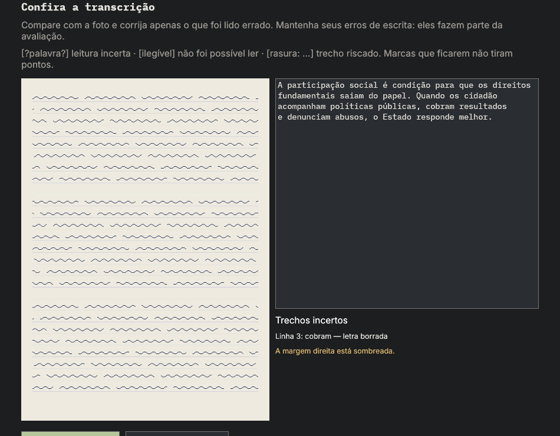</td>
    <td>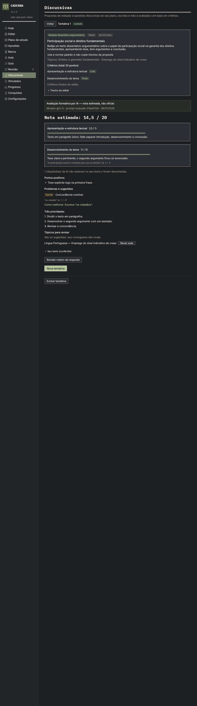</td>
  </tr>
</table>

<table>
  <tr>
    <td>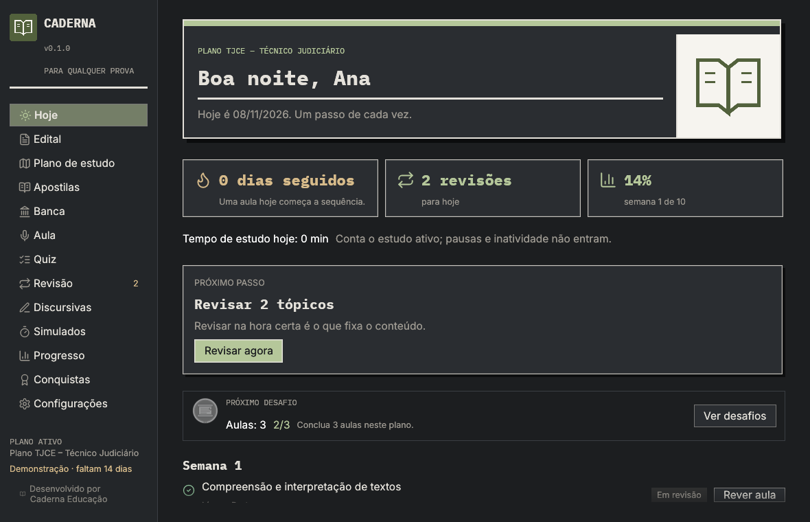</td>
    <td>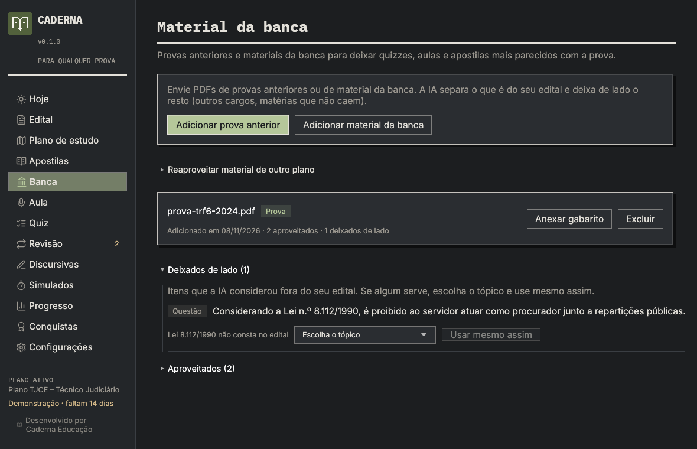</td>
  </tr>
</table>

## Primeiro acesso

Cinco passos curtos antes de tudo: idioma, seu nome, um professor, o serviço de IA com sua
chave de API ou login da conta e os termos. Escolha entre 22 fornecedores com seus logos:
**Z.ai** é a recomendação de custo-benefício e **Claude** a de maior acerto, cada um com o
link para criar a chave. Carregue os modelos que a sua chave pode usar ou digite qualquer
nome de modelo. Depois vem um tour rápido pelas telas. Planos já criados são mantidos.

O GitHub Copilot pode ser conectado com sua conta GitHub pelo Copilot CLI oficial, sem
chave de API. O CLI normalmente guarda as credenciais no chaveiro do sistema operacional;
se ele estiver indisponível, pode recorrer a um arquivo de configuração sem criptografia
(`~/.copilot/config.json`). O Caderna não guarda as credenciais no banco. Esta
integração aceita texto, não imagens.

**Entre com uma conta que você já tem.** O passo da IA abre em *Entrar com conta*, para quem paga um plano de chat e nunca criou uma chave de API: **ChatGPT** (o *Sign in with ChatGPT* oficial da OpenAI: as aulas entram no limite do seu plano), **Claude** (pelo Claude Code, o programa oficial da Anthropic, com a sua conta Claude Pro ou Max; o Caderna pode instalá-lo para você) e **GitHub Copilot**. Cada um faz o login na página do próprio dono; o Caderna nunca vê a sua senha. O Caderna não é afiliado à OpenAI, à Anthropic nem ao GitHub.

<p align="center">
  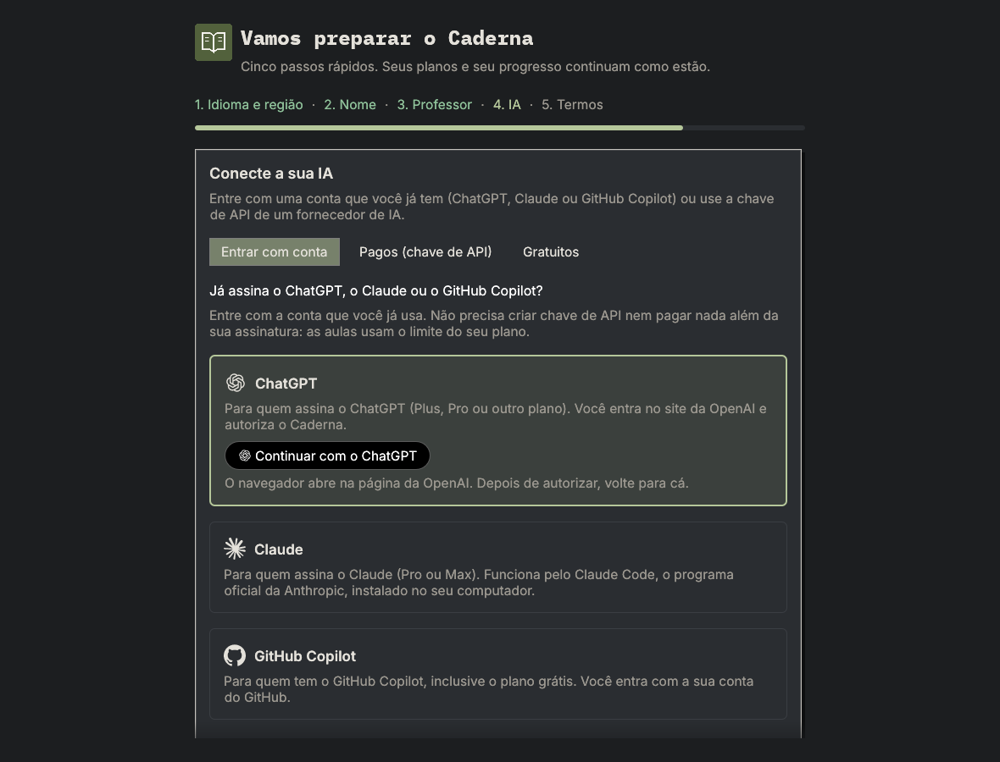
</p>

**Grátis ou pago.** Além de *Entrar com conta*, o passo da IA tem mais duas abas. *Pagos* mostra os serviços recomendados
(Z.ai pelo custo-benefício, Claude pela precisão). *Gratuitos* lista serviços com plano
grátis (Gemini, Mistral, OpenRouter, Groq, NVIDIA, GitHub Models, e Ollama ou LM Studio no
seu computador), cada um com o modelo coberto, o que faz com o que você envia (alguns planos
grátis treinam modelos com isso) e um link para os limites e as regras.

**O jeito de estudar da sua região.** Aulas, quizzes, apostilas e discursivas seguem como se
estuda para provas onde você mora: no Brasil, itens certo/errado do Cebraspe e questões de
cinco alternativas da FCC e da FGV, e redação contada em linhas; no Japão, cinco
alternativas e o 小論文 contado em caracteres; na China continental, o 行测 e o 申论; em
Taiwan e Hong Kong, os formatos dos concursos de lá; nos EUA e no Reino Unido, testes
padronizados, o bar exam e os mark schemes. O programa da prova e as provas anteriores sempre vêm
primeiro.

<p align="center">
  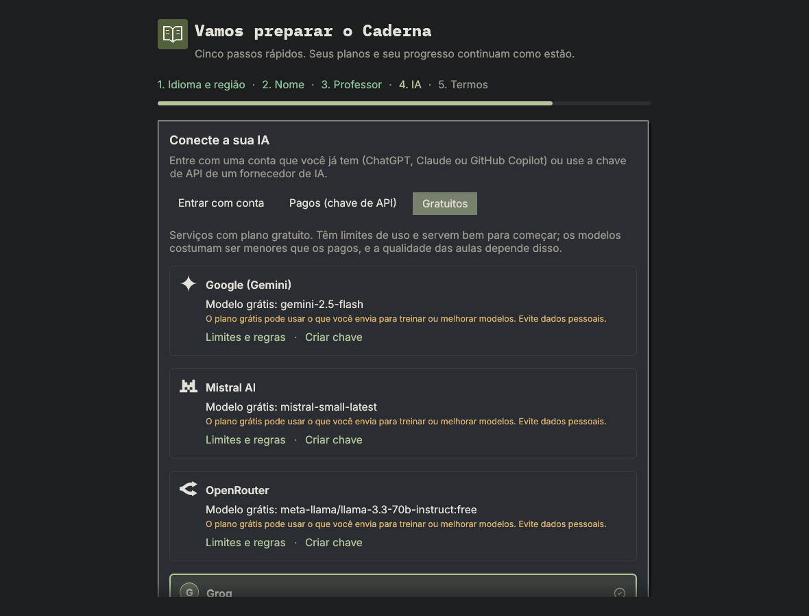
</p>

<table>
  <tr>
    <td>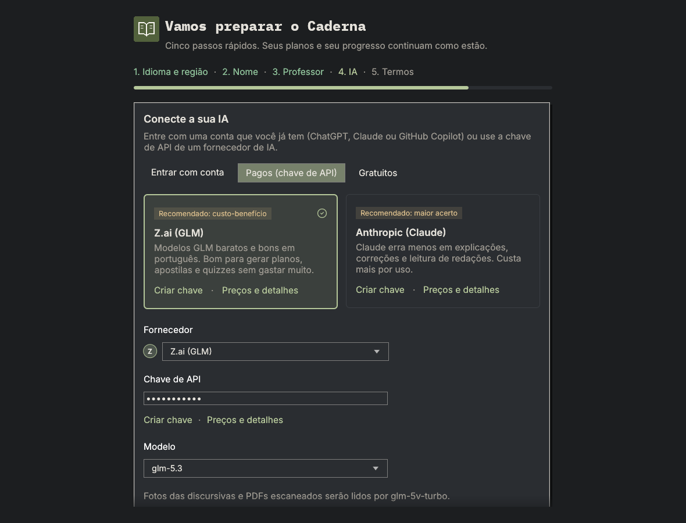</td>
    <td>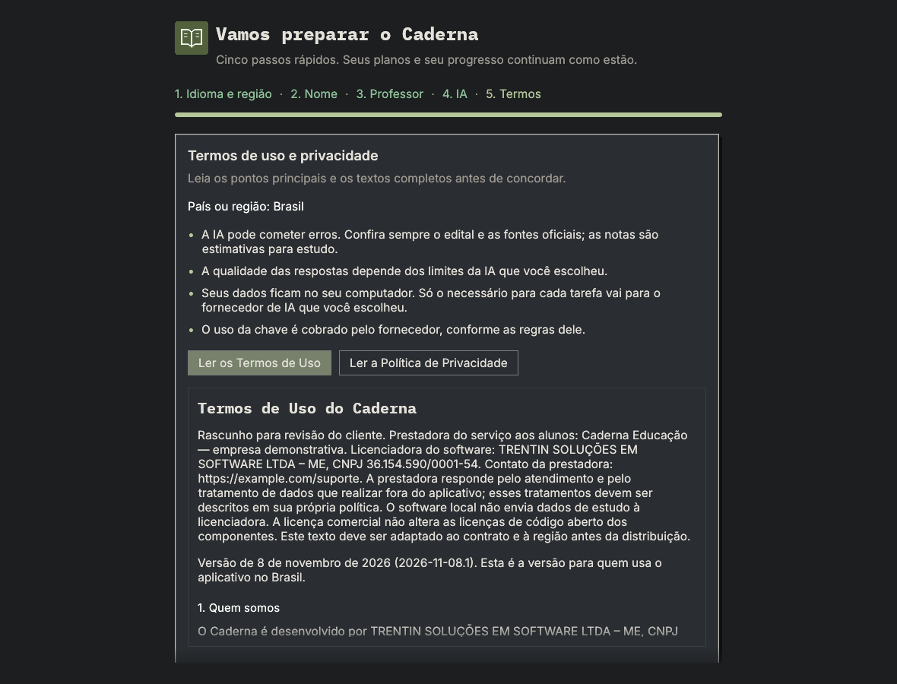</td>
  </tr>
</table>

<p align="center">
  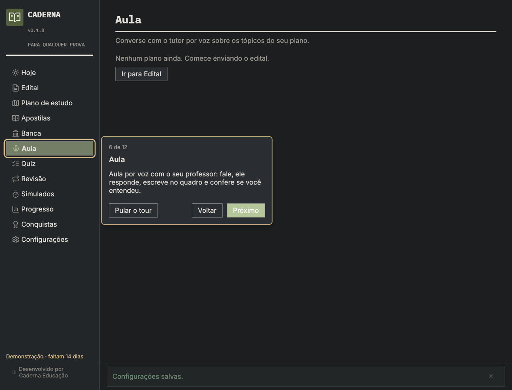
</p>

## Privado por padrão

- O reconhecimento de fala e as vozes rodam no seu computador. As gravações nunca saem
  dele.
- Seus dados (banco SQLite, modelos, log) ficam em `%LOCALAPPDATA%\<data_dir>` (`KnowGiver` no próprio Know Giver), ou em
  `KG_DATA_DIR` quando definido.
- Por padrão, as fotos manuscritas são lidas localmente e não saem deste computador. Se
  você escolher explicitamente a API externa de visão em Configurações → IA, as fotos serão
  enviadas ao fornecedor; no Copilot, o OCR é sempre local. Antes do envio, o app informa
  o destino. As fotos ficam na pasta de dados e são apagadas junto com a tentativa. Os logs
  nunca guardam imagens, respostas ou chaves. Páginas de PDFs escaneados só são enviadas ao
  modelo de visão configurado quando você pede a leitura. A instalação do OCR local baixa
  cerca de 1,82 GB do Hugging Face.
- Quando a marca indica um repositório de releases, o app pergunta ao GitHub qual é a
  versão mais recente ao abrir; só esse pedido sai, e Configurações → Sobre e atualizações
  desliga a busca. Marcas sem repositório nunca buscam.
- Sem conta, telemetria ou anúncios. Leia os [Termos de Uso](docs/legal/terms-of-use.pt-BR.md)
  e a [Política de Privacidade](docs/legal/privacy-policy.pt-BR.md) (LGPD), também
  mostrados no app.

## Versões com marca (white-label)

Este repositório é a **base white-label** do Know Giver: o mesmo app, gerado com nome,
cores e imagens de outra empresa e, se quiser, como **demonstração por tempo limitado**.
Aqui não há releases públicos; cada build é feito para um cliente.

**1. Crie a marca.** Copie `branding/example` para `branding/<cliente>` e edite o
`brand.toml`:

| Seção | O que define |
| --- | --- |
| `[app]` | nome do produto, `slug` (id da janela, nome do banco), `data_dir` (pasta de dados e de instalação), `executable` (nome do arquivo do programa), GUID do instalador |
| `[company]` | nome da empresa, site, crédito "Desenvolvido por …" ligado ou não, licença da marca |
| `[colors]` | destaque e realce (temas claro e escuro), cor do crédito nas apostilas |
| `[assets]` | ícone do app (PNG e ICO), arte de capa, arte do lembrete, marca (SVG) e marca d'água das apostilas (SVG) |
| `[updates]` | repositório GitHub com os releases do cliente, ou vazio para não buscar atualizações |
| `[demo]` | `enabled`, `days` desde o primeiro uso, `expires` (último dia), link de contato |
| extras de `[company]` | `support_url` (Configurações → Sobre), `teachers_dir` e `stickers_dir` para trocar a arte embutida |
| `[legal]` | pasta com os textos legais da marca (um por idioma oferecido), `version` do aceite, prestadora, licenciadora, contato, marcas de revisão |
| `[licensing]` | chave **pública** Ed25519 das licenças, e `required` para parar sem uma |
| `[server]` | o painel da marca: ativação online, download da marca e IA por ele, com os apelidos dos modelos |
| `[locale]` | idiomas e regiões que a marca oferece (vazio: todos) |

**2. Gere o build.** A marca é lida na compilação a partir de `KG_BRAND_DIR` (padrão
`branding/default`, que é o próprio Know Giver):

```powershell
powershell -ExecutionPolicy Bypass -File scripts\package.ps1 -Brand branding\<cliente>
```

Isso cria `dist\<data_dir>-<versão>-windows-x64.zip` e, com o
[Inno Setup 6](https://jrsoftware.org/isinfo.php), `dist\<data_dir>-<versão>-setup.exe`,
ambos com o nome e o ícone do cliente. Para testar rápido:
`$env:KG_BRAND_DIR = "branding/<cliente>"; cargo run --release`.

**Versão de demonstração.** Com `[demo] enabled = true`, o app conta `days` desde o
primeiro uso e/ou para depois de `expires`, o que vier antes. A barra lateral mostra os
dias que faltam; quando o prazo acaba, só abre a tela "A demonstração terminou", com um
botão para o contato do cliente. Planos e progresso continuam no computador. O primeiro
uso e o último dia usado ficam no banco e na pasta de configurações do sistema, então
apagar um deles ou atrasar o relógio não reinicia a demonstração. É uma barreira
comercial, não uma proteção contra cópia.

**Licenças e textos legais por marca:** a marca pode trazer uma chave pública Ed25519;
os alunos do cliente ativam então uma chave de licença (offline, presa à marca, ao
cliente, às vagas e às datas) nas Configurações ou na tela de "demonstração encerrada",
sem tocar nos dados de estudo. A marca também pode trazer seus próprios termos e
política de privacidade, link de suporte, retratos dos professores e figurinhas. O
empacotamento para venda não roda até a marca marcar a revisão jurídica e comercial.
Veja [branding/README.md](branding/README.md); o que falta está no
[ROADMAP](ROADMAP.md). Confira as licenças em [Créditos](#créditos) antes de vender um
build.

**Caderna.** `branding/caderna` é a primeira marca de cliente: papel, grafite e oliva,
ícone, capa e marcas próprios e chave pública Ed25519. É oferecida só no Brasil, em
português do Brasil (`[locale]`), e funciona com o seu painel: avaliações e licenças
vêm de lá. Os
textos legais são rascunhos (`[legal] reviewed = false`), então o empacotamento para
venda continua bloqueado até a revisão. Para rodar:
`$env:KG_BRAND_DIR = "branding/caderna"; cargo run` (fala com o painel em `[server] dev_url`, `http://localhost:8000`; um build de release
precisa do painel online em `[server] url` ou em `KG_SERVER_URL`); cada marca tem a sua pasta
de dados, então nunca se mistura com um Know Giver instalado.

**Emitir licenças.** As chaves são criadas uma vez por marca, e a chave privada nunca
entra no repositório:

```sh
cargo run -p kg-engine --example license_issue -- keygen private.pk8 public.txt
cargo run -p kg-engine --example license_issue -- sign private.pk8 claims.json license.txt
```

**CADERNA-DASHBOARD.** Um projeto separado, em Laravel e Filament, é o painel da Caderna:
lá os clientes são validados, as cores, imagens e textos de cada cliente são definidos, e
tokens de avaliação e licenças são emitidos no mesmo formato que o app verifica offline.
As escolas têm lá uma área do cliente para cadastrar os alunos e pagar as cobranças do
painel por Pix ou cartão de crédito (em até 3x sem juros, pela Asaas).
Ele também tem um gateway de IA compatível com a OpenAI, com as chaves dos provedores só
no servidor, e roda em Docker ou numa instalação PHP local
([czarist/caderna-dashboard](https://github.com/czarist/caderna-dashboard)). Com
`[server] url` definido, o app ativa a licença no painel (uma vaga por computador, token
do aparelho de 7 dias no cofre de credenciais do sistema, renovado sozinho), confere a
licença a cada hora e continua funcionando por 14 dias sem o painel. Ele também baixa o
nome, as cores, os links, as imagens e os textos do cliente e manda as tarefas de IA pelo painel, então o aluno
não precisa de chave de IA. O painel recebe a chave de licença, um hash do identificador
do computador, a versão do app, o sistema operacional e as tarefas de IA, nunca o nome do
computador; a política de privacidade da Caderna diz isso. Veja
[branding/README.md](branding/README.md).

## Começo rápido

```bash
cargo run --release
```

O primeiro acesso pede cinco coisas antes de abrir o resto: idioma, seu nome, um
professor, o serviço de IA com a sua chave e o aceite dos termos. Escolha o fornecedor e o
modelo na lista (**Z.ai** é a recomendação de custo-benefício, **Claude** a de maior
acerto, cada um com o link para criar a chave) ou carregue os modelos que a sua chave pode
usar. Depois vem um tour rápido pelas telas. Planos já criados são mantidos.

Fechar a janela mantém o app na bandeja do sistema: dois cliques no ícone reabrem a janela, e um clique abre o menu (abrir ou sair). Abrir o Caderna de novo com ele já aberto traz de volta a mesma janela; nunca há duas cópias nem dois ícones na bandeja. Na instalação, você escolhe se ele inicia com o sistema e se quer receber lembretes de estudo (a cada 3 horas por padrão, de 30 minutos a 8 horas em Configurações); as duas opções começam desativadas. O lembrete é uma janelinha do Caderna no canto da tela, com as matérias mais atrasadas e um botão para começar a estudar. Os lembretes aparecem quando você está longe do app (na bandeja, minimizado ou atrás de outras janelas), nunca durante aula, quiz ou revisão, e só enquanto houver matérias pendentes no plano ativo.

Para desenvolvimento, o `.env` (copie o `.env.example`) ainda pode definir o endereço e os
modelos; ele tem prioridade sobre variáveis globais com o mesmo nome. Baixe os modelos de
fala nas Configurações. Rust 1.95 ou mais novo.

**Pacote para Windows:** veja [Versões com marca](#versões-com-marca-white-label)
(`scripts\package.ps1 -Brand branding\<cliente>`).

## Desenvolvimento

```
crates/
  app/      # binário know-giver (ponto de entrada, ícone e dados de versão da marca)
  brand/    # kg-brand: a marca do build, lida do brand.toml na compilação
  ui/       # interface egui (telas, tema, traduções)
  engine/   # estado do app, comandos, trabalho em segundo plano, ciclo de voz
  study/    # planos, revisões (SM-2), quizzes, armazenamento SQLite
  ai/       # cliente compatível com OpenAI + prompts (crates/ai/prompts/{pt,en})
  audio/    # captura do microfone, STT Parakeet/Whisper, TTS Piper/Kokoro, reprodução, downloads
  pdf/      # extração do texto do programa da prova, cargos
  handout/  # apostilas renderizadas em PDF com Typst
locales/    # traduções da interface (pt-BR, en, ja, zh-Hans, zh-Hant)
branding/   # pastas de marca: default (Know Giver), example (modelo), caderna (cliente)
tools/      # geradores de arte (ícone, retratos dos professores)
```

As dependências seguem um sentido só: `app → ui → engine → {study, ai, audio, pdf, handout}`.
Veja [docs/architecture.md](docs/architecture.md) (em inglês, como o resto da documentação
técnica).

```bash
cargo fmt
cargo clippy --workspace --all-targets -- -D warnings
cargo test --workspace
```

Os builds usam todos os núcleos da CPU (padrão do Cargo). Para limitar uma execução,
passe `-j N`. Um `.cargo/config.toml` local, ignorado pelo git, escolhe a marca do
`cargo run` simples: `[env] KG_BRAND_DIR = { value = "branding/caderna", relative = true }`.

Verificações manuais com os serviços reais (precisam do `.env` e de rede):

```bash
cargo run -p kg-ai --example live_check                          # todas as tarefas de IA (KG_PROMPT_LANG=en para prompts em inglês)
cargo run -p kg-engine --example e2e -- edital.pdf                # importar → plano → quiz → revisão → apostila
cargo run --release -p kg-audio --example parakeet_check -- <pasta-dos-modelos> fala.wav
KG_SNAPSHOT_DIR=shots cargo test -p kg-ui snapshots -- --ignored  # gera um PNG de cada tela
```

Mais: [builds nativos/CUDA](docs/builds.md), [avaliação do Kokoro](docs/kokoro-evaluation.md),
[notas de validação](docs/validation-v0.15.md),
[conferência manual das discursivas](docs/validation-discursive.md).

## Créditos

- Ícone do app e arte da capa: Thoth como babuíno sob a lua crescente, num ladrilho de
  jade, por [Cezar Trentin](https://cezartrentin.dev) (`crates/ui/assets/art/thoth-tile.png`);
  `python tools/icon.py` gera os ícones do app e do Windows a partir dela.
- Ícone, capa, arte do lembrete e marcas da Caderna (`branding/caderna`): arte original
  feita para a marca Caderna, sob a licença do projeto.
- Fontes: [Inter](https://rsms.me/inter/) e [IBM Plex Mono](https://github.com/IBM/plex),
  SIL Open Font License (`crates/ui/assets/fonts`).
- Retratos dos professores (`crates/ui/assets/teachers`): "Lorelei", de Lisa Wischofsky,
  CC0 1.0, via [DiceBear](https://www.dicebear.com/styles/lorelei/); refeitos com
  `python tools/teachers.py`.
- As imagens do quadro vêm da [Wikipédia](https://pt.wikipedia.org); a legenda indica o
  artigo, onde estão o autor e a licença de cada imagem.
- Ícones: [Lucide](https://lucide.dev), licença ISC (`crates/ui/assets/icons`).
- Ícones das conquistas (`crates/ui/assets/stickers`): SVGs originais feitos para o Know
  Giver, sob a licença do projeto.
- Logos dos fornecedores de IA: [Simple Icons](https://simpleicons.org), CC0
  (`crates/ui/assets/providers`); os logos são marcas dos seus donos, usados só para
  identificar cada serviço.

## Licença

Licenciado sob [MIT](LICENSE-MIT) ou [Apache License 2.0](LICENSE-APACHE), à sua escolha
(`MIT OR Apache-2.0`). Salvo indicação em contrário, qualquer contribuição enviada para
inclusão no projeto fica sob as duas licenças, sem termos adicionais.

Fontes, retratos e vozes de terceiros mantêm suas próprias licenças, listadas em
[Créditos](#créditos). Para relatar uma vulnerabilidade, veja [SECURITY.md](SECURITY.md).
